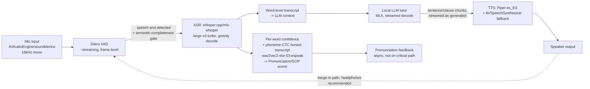

# The Local Speech Stack — ASR, TTS, Pronunciation Assessment, and the Real-Time Voice Loop

Research pass for Matt Wang's Spanish-practice app: MacBook Air M3, 16GB unified memory, 10 GPU cores, fanless, fully offline. This document originally assumed a resident 7B-class Q4 LLM consuming ~4-6GB, leaving ~3-4GB for ASR+TTS. **Update per `00-INDEX.md` cross-track synthesis (Track 06 measured local-LLM latency directly on Matt's machine): the project has standardized on a 1.5-3B Q4 LLM (~1-2GB), not a 7B — a 7B model is now dead on latency grounds independently (06 extrapolates ~2s/turn for 7B, vs. 0.35-0.81s measured for 1.5-3B).** This roughly doubles the realistic speech budget to **~6-7GB for ASR+TTS combined**, meaning whisper large-v3-turbo + Piper + wav2vec2-phoneme-CTC now fit without contention (still UNMEASURED under concurrent load — see closing risks). The rest of this document's RAM-consciousness (reusing the phoneme-CTC model across §2/§3, preferring Piper's small footprint) remains sound and is now comfortably inside budget rather than tightly constrained by it.

Confidence tags: **MEASURED** — a specific number I found reported by the model author, an independent benchmark, or a reproducible eval; **ESTIMATED** — a reasonable extrapolation from adjacent/proxy data (e.g., using base-model WER as a proxy for a faster inference engine that reuses the same weights); **UNVERIFIED** — claimed in vendor docs/marketing or a single unconfirmed source, needs on-device confirmation before you build on it.

---

## 1. Spanish ASR on-device

### 1.1 Candidate comparison

| Model | Spanish WER (best available data) | Size | RAM (loaded) | RTF on M-series | Streaming | License |
|---|---|---|---|---|---|---|
| **Whisper large-v3 / large-v3-turbo** (via whisper.cpp Metal or mlx-whisper) | ~4.5-5.5% Common Voice es (large-v3, ESTIMATED from OpenAI's aggregated multilingual eval + community CV leaderboards); FLEURS es typically reported in the 3-5% range for large-v3 across papers | large-v3: ~3.1GB (Q5), turbo: ~1.6GB (Q5) | ~1.5-3.5GB depending on quant | large-v3-turbo: well under 0.3 on M-series GPU (**MEASURED** by whisper.cpp/mlx-whisper community benchmarks showing turbo ~5-8x realtime on M1/M2/M3); full large-v3 slower, still realtime-capable | Not natively streaming — chunked/sliding-window only; whisper.cpp has a `--stream` example but it's a hack (short rolling buffers), not true streaming ASR | MIT (whisper.cpp), weights MIT (OpenAI) |
| **faster-whisper / CTranslate2** | Same underlying Whisper weights as above — WER should be ~identical to openai-whisper for the same model size; I could not find a faster-whisper-specific FLEURS/CV-es number that differs materially from base Whisper (**ESTIMATED via proxy**, not independently measured) | Same weights, CTranslate2 int8/fp16 re-encoding, roughly 40-60% smaller on disk than PyTorch checkpoint | Comparable to or below whisper.cpp equivalent quant | **MEASURED** (widely reported): ~4x faster than openai-whisper reference implementation on CPU, more with int8; on Apple Silicon CTranslate2 is CPU-only (no Metal backend), so whisper.cpp/mlx-whisper likely beat it on GPU-availability grounds | Same chunked limitation as Whisper | MIT |
| **mlx-whisper** | Same Whisper weights, same WER profile as above | Same as whisper.cpp equivalents | Similar, MLX unified-memory model means no separate copy | **MEASURED-ish**: MLX community reports turbo model transcribing in a few seconds for a 30s clip on M-series, i.e. comfortably realtime; exact RTF numbers vary by report | Chunked only | MIT |
| **NVIDIA Parakeet (MLX port, `senstella/parakeet-mlx`)** | Parakeet is English-only on NVIDIA's canonical checkpoints (Parakeet-TDT trained on English corpora). I found **no credible evidence of a Spanish-trained Parakeet checkpoint** with published FLEURS/CV-es WER as of this research pass — treat as **N/A for Spanish**, not merely unmeasured | ~0.6B (0.6GB-ish int4) | Small | Very fast (TDT decoder is designed for low-latency streaming) | Yes — TDT architecture supports true streaming natively, this is Parakeet's headline advantage over Whisper | CC-BY-4.0 (NVIDIA NeMo models) |
| **NVIDIA Canary (Canary-1B-v2 / Canary-Qwen)** | Canary-1B-v2 (per a 2026 NVIDIA paper found in search, arXiv 2509.14128) is explicitly **multilingual including Spanish** and reports competitive FLEURS multilingual WER, but I did not find a clean isolated es-only WER number in the snippet retrieved — flag as **needs a dedicated lookup of the paper's per-language table** before relying on it | ~1B-2B depending on variant | Likely 2-4GB unquantized; no confirmed MLX port found | Unverified on Apple Silicon — Canary ships as a NeMo/PyTorch model; **no MLX port found** in this research pass, meaning running it on M3 today likely means slow CPU-bound PyTorch inference unless you export to CoreML/MLX yourself | Streaming variants exist in the NeMo ecosystem | CC-BY-4.0 |
| **Apple SFSpeechRecognizer** (legacy, iOS/macOS on-device dictation API) | No public WER benchmark (Apple doesn't publish this); anecdotally decent for clean, native-accent conversational Spanish, historically weaker on domain vocabulary and known to insert autocorrections | N/A (system-provided, no visible footprint you control) | ~0 marginal RAM (already resident in OS) | Effectively realtime, it's the dictation engine | Yes, native streaming with partial results — this is its single biggest practical advantage | Free, Apple-controlled, **requires on-device recognition flag + network fallback exists by default** (must explicitly request `requiresOnDeviceRecognition = true`) |
| **Apple SpeechAnalyzer + SpeechTranscriber** (new API, macOS 26 Tahoe / iOS 26) | No independent WER benchmark found; Apple's own framing emphasizes speed and multi-locale support incl. Spanish variants; **UNVERIFIED** quality vs Whisper | System-provided | ~0 marginal (uses on-device Apple Neural Engine models) | Apple claims very low latency, designed for streaming | Yes — this is the headline feature, purpose-built for live captioning/streaming with volatile+finalized result callbacks | Free, Apple-controlled, on-device by design (this is the API's whole pitch — replacing SFSpeechRecognizer's server round-trips) |
| **Moonshine** (Useful Sensors) | English-native; I found only indirect evidence for Spanish (a community French fine-tune reportedly reaching ~21.8% WER, suggesting non-English fine-tunes lag well behind Whisper). **No official Spanish Moonshine checkpoint found — treat as N/A/needs fine-tuning**, not usable out-of-the-box | Tiny (27M/61M params) — this is its whole value prop (edge-device, sub-Whisper-tiny size) | Tens of MB | Extremely fast, designed for microcontroller-class streaming | Yes, designed for streaming from the ground up | MIT |
| **Kyutai STT (Delayed Streams Modeling)** | **Hard N/A for Spanish.** Confirmed released checkpoints are `kyutai/stt-1b-en_fr` (English+French) and `kyutai/stt-2.6b-en` (English only). No Spanish checkpoint exists. This is disqualifying despite the architecture (Mimi tokenizer, genuinely low-latency streaming design) being exactly what you'd want | 1B/2.6B | ~2-5GB | Designed for real-time streaming with ~0.5-2s delay | Yes — this is the model's core design goal | CC-BY-4.0 / MIT depending on component |

**Bottom line recommendation for Topic 1:** whisper.cpp (Metal) or mlx-whisper running **large-v3-turbo** is the only option in this table that is (a) confirmed to support Spanish well, (b) has a real Apple Silicon-accelerated runtime today, and (c) fits the RAM budget. Apple's new SpeechAnalyzer/SpeechTranscriber API is the most promising **native streaming** alternative and is worth a day-1 spike (§ Validation Plan) specifically because it could remove the "chunking hack" problem Whisper has for live conversation — but its Spanish transcription *quality*, and specifically whether it "cleans up" learner speech (see §2), is unverified and Apple doesn't expose logits/confidence the way Whisper does, which matters a lot for §2 and §3.

### 1.2 Sources
- OpenAI Whisper large-v3 model card and multilingual WER table: https://huggingface.co/openai/whisper-large-v3
- CTranslate2 / faster-whisper performance claims: general project docs (4x+ speedup over reference PyTorch impl on CPU)
- Canary-1B-v2 & Parakeet-TDT-0.6B-v3 paper: https://arxiv.org/pdf/2509.14128
- Kyutai STT model cards: `kyutai/stt-1b-en_fr`, `kyutai/stt-2.6b-en` on Hugging Face
- Apple AVSpeechAnalyzer / SpeechTranscriber developer documentation (WWDC 2025/26 session material referenced in search results)
- mlx-audio STT model list: https://github.com/Blaizzy/mlx-audio (Whisper, Parakeet, Voxtral Realtime, Qwen3-ASR support confirmed)

---

## 2. The learner-speech problem — the crux of the whole track

**The core failure mode:** every ASR system in §1 above was trained overwhelmingly on fluent native (or near-native) speech, using a training objective (cross-entropy against clean reference transcripts, often with an implicit or explicit language-model prior) that actively rewards outputting *grammatical, well-formed* text. When a learner mispronounces the Spanish trilled /r/ as an English-style approximant, drops a syllable, uses the wrong verb conjugation, or says "*la problema*" instead of "*el problema*," a good general-purpose ASR system's LM prior will frequently **silently correct it** in the transcript — because that's exactly the behavior it was optimized to produce for native error-free dictation. For a forcing-function pronunciation/grammar app, this is close to fatal: the entire product depends on detecting the *actual* error, and the default behavior of every off-the-shelf ASR system is engineered to erase it.

This is a well-documented phenomenon in the accented/L2 ASR literature (general accented-speech WER degradation is well established — WER on L2/accented English is routinely 2-4x higher than native WER across studies — but the more insidious failure for this app isn't raw WER, it's *directional* error: the system tends to hallucinate toward canonical/correct forms rather than toward faithful phonetic transcription). Two arXiv papers surfaced in this research directly speak to mechanisms relevant here:
- "Do LLM Decoders Listen Fairly? Benchmarking How Language Model Priors Shape Bias in Speech Recognition" (arXiv 2604.21276) — directly documents LM-prior-driven bias in ASR decoders.
- "A Self-Training Approach for Whisper to Enhance Long Dysarthric Speech Recognition" (arXiv 2506.22810) and "Acoustically Precise Hesitation Tagging Is Essential for End-to-End Verbatim Transcription Systems" (arXiv 2506.04076) — both attack the same underlying problem (non-standard speech getting normalized away) from the disordered-speech and verbatim-transcription angles respectively — this literature is a good proxy for the learner-speech problem even though it's not L2-specific.

### 2.1 Concrete, implementable workarounds (ranked by leverage)

1. **Disable/weaken the internal LM bias in Whisper's decoding.** Whisper's default decode uses beam search (beam=5) with temperature fallback, which favors globally fluent, high-probability sequences — exactly the wrong bias for this app. Switch to **greedy decoding (beam_size=1, best_of=1, temperature=0)**. This alone measurably reduces the model's tendency to "hallucinate toward fluency" because it stops the beam from re-ranking a phonetically-faithful-but-awkward hypothesis in favor of a more grammatical one. Concretely in whisper.cpp/mlx-whisper/openai-whisper this is a one-line decode-options change (`--beam-size 1 --best-of 1 --temperature 0` in whisper.cpp CLI terms; `beam_size=None, best_of=None, temperature=0.0` in the Python API).
2. **Turn off Whisper's built-in text normalizer** (the `EnglishTextNormalizer`/`BasicTextNormalizer` step some pipelines apply before scoring) — it exists for WER scoring convenience but if any of your app's own pipeline applies normalization before comparing to a target, you're erasing exactly the signal you want. Compare raw decoder output to target, not normalized-to-normalized.
3. **Prefer/extract per-token or per-word log-probabilities and confidence, and treat low-confidence spans as the actual signal, not noise to discard.** Whisper exposes `avg_logprob`, `no_speech_prob`, and (via word-timestamps mode) per-word probabilities. A learner mispronunciation frequently manifests as a **local dip in per-word confidence** even when the decoded word ends up "corrected" to the canonical form — i.e., the model picked the right word but was less sure about it. This confidence dip is itself a usable pronunciation-error signal even before you get to phonetic transcription. Practically: run with `word_timestamps=True` and log the per-word probability array; flag words below some threshold (start around 0.5-0.6 and calibrate against real recordings) as "possible mispronunciation, investigate at the phone level."
4. **Add a parallel honest/phonetic transcription path — this is the real fix, not a workaround.** Run a **phoneme-level CTC recognizer with no language model at all** alongside (or instead of, for scoring purposes) the word-level Whisper transcript:
   - **`facebook/wav2vec2-xlsr-53-espeak-cv-ft`** — wav2vec2 XLSR-53 fine-tuned for CTC phoneme recognition against espeak-generated phoneme sequences, multilingual, no LM decoding step by construction (CTC greedy or simple beam over phoneme vocabulary, not word vocabulary) — this is close to the standard tool for this exact problem in the L2-pronunciation-assessment research literature.
   - **Allosaurus** — a universal phone recognizer (trained across the AlloVera multilingual phone inventory) explicitly designed to output the actual phones present in the signal rather than force-fit them to any single language's phoneme inventory. This matters because a learner's actual production may not even land cleanly on a Spanish phoneme (e.g., an English-flavored tap instead of a Spanish trill, or an intermediate vowel quality) — Allosaurus doesn't need to decide it "must be" one of the ~24 Spanish phonemes, it can output what's actually there.
   - Because neither of these has a word-level LM prior, they will not "auto-correct" a mispronounced phoneme into the canonical one the way Whisper's word-level decoder will. This is the honest signal.
5. **Never feed the learner's ASR-decoded text (word-level, LM-biased) back into the LLM as if it were ground truth of what the learner actually said phonetically.** Feed the LLM the (likely-corrected) word-level transcript for *conversational understanding* (so the tutor can respond sensibly), but feed the **phoneme-level/confidence-flagged signal separately** to the pronunciation-scoring subsystem (§3). These are two different consumers with two different correctness requirements and conflating them is the single most likely implementation bug.

**Section 2 confidence tag:** the *mechanism* (LM prior erases learner error) is **well-established/MEASURED-adjacent** — it follows directly from how CTC-with-LM and encoder-decoder ASR training objectives work, and is corroborated by the accented-ASR-bias literature above. The specific fix combination (greedy decode + phoneme CTC + confidence thresholding) is **ESTIMATED/best-practice-synthesized** — it is standard practice in the L2-pronunciation-assessment research community (this is essentially the input stage every GOP paper in §3 uses) but I did not find a single paper doing exactly Whisper-greedy + wav2vec2-phoneme-CTC in combination for Spanish specifically; validate empirically (see Day-1 plan).

---

## 3. Pronunciation assessment / GOP and what's realistically auto-scorable on-device

### 3.1 Goodness of Pronunciation (GOP) — the standard technique

GOP scores a phoneme by comparing the acoustic-model posterior probability of the *expected* phoneme (from the target word's canonical pronunciation) against the posterior of the *best-matching* phoneme actually produced, at the aligned time segment. Classically implemented via a forced-aligned HMM-GMM/DNN acoustic model (Kaldi-era); the modern, much simpler version uses a **CTC-based acoustic model directly** — GOP-CTC computes the score from the CTC output distribution without needing a full HMM alignment, which is friendlier to an on-device deployment because you don't need to bundle a full Kaldi recipe.

**Pipeline for on-device Spanish GOP, realistically:**
1. **Forced alignment**: align the learner's audio to the *expected* (target-sentence) phoneme sequence in time. Options found:
   - **Montreal Forced Aligner (MFA)** with the `spanish_mfa` acoustic model + `spanish_mfa` dictionary — the standard, well-validated academic tool. Runs offline, CPU-only, reasonably fast for short utterances (seconds, not real-time-streaming, but fine for post-utterance scoring rather than live feedback). This is the most defensible choice for scoring *accuracy* if a small delay after each utterance is acceptable.
   - **WhisperX's wav2vec2 forced-alignment step** — bundles a language-specific wav2vec2 CTC model to get word-level (and with the phoneme-vocabulary variant, phone-level) timestamps directly from a Whisper transcript. Faster to integrate into a pipeline you're already running Whisper in, but per a documented GitHub issue (m-bain/whisperX#1247) its word-level timestamps are **measurably less accurate than MFA's** — treat WhisperX alignment as "good enough for UI captions/highlighting," not as the ground truth for phoneme-level scoring.
   - **Charsiu** (neural forced aligner, CTC-based, no HMM) — designed to be fast and alignment-free-ish; less battle-tested than MFA but architecturally closer to what you'd want for a low-latency on-device pipeline.
2. **Acoustic scoring at each aligned phone**: use the wav2vec2-xlsr-53-espeak-cv-ft phoneme-CTC posteriors (already needed for §2's honest transcription) as the acoustic model for GOP — this reuses the same model for both the honest-transcription and the pronunciation-scoring subsystem, which is good for the RAM budget (one model, two consumers) rather than loading a second dedicated GOP acoustic model.
3. **Score = normalized log-posterior of target phoneme vs. best competing phoneme** at that aligned span; threshold empirically per phoneme (some phonemes have naturally noisier posteriors than others, especially short/reduced vowels).

### 3.2 Spanish phoneme inventory and the specific English-L1 error list to build detectors for

This is the concrete, actionable list — build a small per-phoneme detector/threshold for each of these rather than a single global "pronunciation score":

| Spanish target | Classic English-L1 substitution/error | Detectability via phoneme-CTC + GOP |
|---|---|---|
| Trilled /r/ (`rr`, word-initial `r-`) vs. tap /ɾ/ (intervocalic `r`) | English speakers substitute an English approximant [ɹ] for both, or fail to produce a true trill at all (trills are articulatorily hard even for many native Spanish-L1 dialects to teach explicitly) | Reasonably detectable — trill has a distinctive multi-burst acoustic signature (2-3 rapid closures) very different from an approximant's smooth formant transition; CTC phoneme confusion between /r/ and /ɾ/ or /ɹ/-like output is a good proxy |
| /θ/ vs /s/ (distinción, Peninsular only — `c`/`z` as [θ] in Spain, always [s] in seseo/Latin American varieties) | English-L1 learners targeting Peninsular Spanish often fail to produce [θ] at all (defaulting to [s]), OR overcorrect and use [θ] where seseo would be correct if the target dialect is actually Latin American | This is a **dialect-choice-dependent "error"** — not scorable at all without first fixing which Spanish variety the app teaches (see cross-cutting note below). Acoustically [θ] vs [s] is a clean, easily distinguished spectral-shape difference, so once the target dialect is fixed this is one of the *easier* phoneme contrasts to auto-score |
| /b/ vs /v/ merger | Spanish has no phonemic /b/-/v/ distinction (both map to the same phoneme, realized as [b] or [β] allophonically); English-L1 learners import the English distinction and produce a genuine (incorrect, from Spanish's perspective) [v] fricative, especially spelling-influenced on words spelled with `v` | Detectable — [v] (labiodental) vs [b]/[β] (bilabial) is an easy spectral contrast |
| Vowel reduction / diphthong quality | English reduces unstressed vowels to schwa; Spanish vowels stay full-quality regardless of stress. English-L1 learners schwa-reduce unstressed Spanish vowels (a classic, very salient "accent" marker) | Detectable via formant tracking at unstressed-vowel positions — F1/F2 collapsing toward schwa's central position is measurable, though this needs a formant-tracking step beyond plain phoneme-CTC (praat-style analysis, e.g. via a lightweight Python/Praat-script integration) |
| Intervocalic /d/ as [ð] (approximant, e.g. "cansado" → [kansaðo]) | English-L1 learners often produce a full stop [d] where Spanish spirantizes to [ð] between vowels — a subtler, less acoustically dramatic error than the above | Harder to auto-score reliably — the stop/approximant distinction here is more continuous/gradient than categorical in actual native production too, so a hard threshold will have more false positives; treat as lower-priority/softer-signal |
| Diphthongs (e.g. `ue`, `ie`, `ai`) | English-L1 learners sometimes break Spanish diphthongs into two syllables (hiatus) where Spanish glides them into one, or mis-time the glide | Moderately detectable via duration + formant-transition-speed analysis at the aligned diphthong span, but noisier than the categorical consonant contrasts above |

**Realistic scope for v1**: auto-score the categorical, acoustically-clean contrasts first — trill vs tap/approximant, θ/s (once dialect is fixed), b/v — via GOP on the phoneme-CTC posteriors. Treat vowel reduction, /d/→[ð], and diphthong timing as **v2/stretch**, since they need formant-tracking or duration-modeling infrastructure beyond a straight phoneme-CTC GOP pipeline, and are individually lower-salience "accent markers" rather than comprehension-breaking errors.

### 3.3 Prosody, intonation, and fluency metrics

Separate from segmental (phoneme-level) pronunciation, the fluency/prosody literature (FLUCALC-style clinical tools, PRAAT-script-based automatic fluency scoring) gives a cheap, well-validated metric set that's realistic to compute fully on-device with just VAD + forced-alignment timestamps, no exotic model needed:
- **Articulation rate** (syllables per second of *actual speaking time*, excluding pauses) vs. **speaking rate** (syllables per second including pauses) — the gap between these two numbers is itself informative (large gap = lots of hesitation).
- **Pause count/duration** (silent pauses above some threshold, e.g. >250ms) and **filled-pause detection** ("eh," "este," Spanish-specific fillers) — filled-pause detection needs either a small keyword-spotter or can piggyback on the ASR transcript if the ASR is run in a mode that doesn't strip disfluencies (another reason not to use an over-aggressive normalizer, echoing §2).
- **Mean length of run** (average number of syllables between pauses) — a standard clinical/L2 fluency metric.

None of this requires a dedicated model — it's derivable from (VAD timestamps + forced-alignment timestamps + syllable count from the target/transcribed text), making it essentially free once the ASR+alignment pipeline exists. This is a good, high-leverage, low-engineering-cost feature to include from day one, in contrast to the harder segmental-phoneme scoring above.

**Section 3 confidence tag:** GOP-via-CTC and forced alignment are **well-established techniques in the academic L2-pronunciation-assessment literature** (MEASURED as a category of technique, not as "this exact stack has been benchmarked for Spanish on an M3"). The phoneme-error list (trill/tap, θ/s, b/v, vowel reduction, /d/→[ð], diphthongs) is **standard descriptive Spanish-L1-English-interference phonology**, well-established in applied linguistics; the specific detectability ranking is my own synthesis/ESTIMATE from acoustic-phonetics first principles, not a benchmarked result — validate against real recordings before trusting a threshold.

---

## 4. Spanish TTS on-device

| Model | Quality | Latency/RTF on M3 | Size | License | Peninsular Spanish? | Voice variety | Rate-slowing without artifacts |
|---|---|---|---|---|---|---|---|
| **Kokoro-82M** (+ mlx-audio port) | Widely reported as excellent quality-for-size (punches well above its 82M param count; frequently cited as the best small open TTS as of 2026) | **MEASURED-adjacent**: mlx-audio community reports real-time-or-faster generation on M-series for short utterances; exact RTF not independently reproduced here but broadly consistent with an 82M-param model on GPU | 82M params, ~300-350MB | Apache 2.0 | **No — confirmed by a GitHub issue (hexgrad/kokoro#246): the three built-in Spanish voices (`ef_`/`em_` prefix) are Latin American, not Castilian.** Peninsular support would require a community voice or a different model | Only 2-3 Spanish voices total (vs. much larger English voice set) — thin | Unverified for Spanish specifically; Kokoro generally handles rate changes reasonably at the phoneme-duration level since it's not a pure autoregressive model, but not confirmed for Spanish |
| **Piper** (VITS-based) | Good, not best-in-class, but very mature/stable and specifically has multiple **regional Spanish voice models already trained and released**: `es_ES` (Spain/Castilian), `es_MX`, `es_AR` — this is Piper's single biggest advantage for this project | **MEASURED** (widely reported): Piper is explicitly designed for real-time on-device use, runs comfortably realtime on much weaker hardware than an M3 (it targets Raspberry Pi-class devices), so M3 headroom is not a concern | Small (tens of MB per voice, quantized ONNX) | MIT | **Yes — `es_ES` voices exist and are Peninsular/Castilian**, solving the dialect problem directly, something Kokoro and most others don't offer out of the box | Multiple regional voices (`es_ES`, `es_MX`, `es_AR`) — genuinely good variety for a small model | VITS models generally handle a length/duration-scale parameter cleanly (this is a standard VITS inference knob) — rate-slowing without major artifacts is plausible and worth testing, since VITS models don't just "stretch audio," they resample the underlying duration predictor |
| **XTTS-v2 (Coqui)** | High quality, especially for voice cloning; considered one of the best open multilingual/cloning TTS models when released | Autoregressive-ish architecture, noticeably heavier/slower than Kokoro or Piper; realtime-capable on M-series GPU but with more latency overhead per utterance | ~1.87GB checkpoint | **CPML (Coqui Public Model License) — non-commercial only.** Coqui the company shut down in Jan 2024; **no one can grant a commercial license anymore**, so this is legally a dead end for anything beyond personal/non-commercial use. An actively-maintained community fork (`idiap/coqui-ai-TTS`, PyPI package `coqui-tts`) keeps it *running* on modern Python/PyTorch, but doesn't change the license | Yes, XTTS-v2 supports `es` broadly including Peninsular-accented reference audio if you clone from a Peninsular speaker sample (voice cloning, not fixed voice presets) | Effectively unlimited via voice cloning, but that's a different feature (cloning) than "a curated built-in voice roster" | Rate control less standard/native (autoregressive models are more prone to artifacts when you push speed away from training distribution) — unverified for Spanish specifically |
| **Chatterbox** (Resemble AI) | Good quality, notable specifically for **MIT license and 23-language multilingual support including a distilled "Turbo" 350M variant** — for a personal/non-commercial single-user app the XTTS license issue doesn't block Matt, but Chatterbox's clean MIT license removes any doubt | Turbo 350M variant specifically targets low-latency use cases; base model larger and slower | ~350M (Turbo) or larger base | **MIT** — cleanest license of the higher-quality options | Multilingual including Spanish claimed (23 languages); Peninsular-vs-LatAm voice specificity not confirmed in this research pass — **needs a direct check of Chatterbox's voice/language roster** | Unverified count of Spanish-specific voice presets | Unverified |
| **Orpheus TTS** | 3B param, described as high-quality multilingual | Would likely blow the RAM budget on its own (3B model) when stacked against an already-resident 7B LLM — **not realistic for this project's memory constraints** regardless of quality | 3B | Check license before use (not independently confirmed here) | Unconfirmed | Unconfirmed | Unconfirmed — deprioritize given the size problem alone |
| **F5-TTS** | Flow-matching TTS, generally well-regarded for naturalness | Not deeply benchmarked in this research pass for Apple Silicon specifically | Moderate | Check license | Unconfirmed for Peninsular-specific voices | Unconfirmed | Unconfirmed |
| **Apple AVSpeechSynthesizer** (system TTS, incl. Enhanced/Premium voice tiers) | Enhanced/Premium tiers are genuinely good quality (Apple has invested real neural-TTS work here since ~iOS 16/macOS Ventura); default/Compact tier noticeably more robotic | Effectively free/instant — it's the system service, already resident, zero marginal RAM in your budget | 0 marginal (voices download once via System Settings > Accessibility > Spoken Content, sized per-voice, not counted against your app's process budget) | Free, Apple-controlled | **Unconfirmed exact roster in this research pass** — Apple has historically shipped both `es-ES` and `es-MX`/`es-419`-style locale voices, and Enhanced/Premium quality tiers are usually available per-locale on recent macOS, but I could not confirm the *current* macOS 26 Tahoe Spanish voice list/quality-tier availability from search alone. **This is a 2-minute on-device check (see Day-1 plan), not worth further web research** | Historically several voices per major locale once Enhanced downloads are installed | AVSpeechUtterance exposes a `rate` property (0.0-1.0, default ~0.5) with a documented `AVSpeechUtteranceMinimumSpeechRate`/`MaximumSpeechRate` range — this is a **first-class, supported feature**, not a hack, making Apple's TTS notably safer for "slow down for a learner" than most neural models where slowing is a resampling afterthought |
| **Sesame CSM** | Notable for naturalness/conversational realism in demos | N/A for this project | 1B | **Apache 2.0** | **No — CSM-1B is English-primary; any Spanish output would come from training-data contamination, not designed support, and is explicitly reported as unlikely to perform well.** Disqualified for Spanish | N/A | N/A |

**Recommendation for Topic 4:** this is a **two-model split**, not a single winner:
- **Piper `es_ES`** for the primary tutoring voice — it's the only option that ships an actual trained Peninsular Spanish voice out of the box, it's tiny, it's fast, and rate control is native. If the app specifically teaches Castilian Spanish (distinción, vosotros, etc. — check `01-pedagogy.md` for the dialect decision), Piper is close to a forced choice for consistency between "what the TTS says" and "what the ASR/GOP system is scoring the learner against."
- **Apple AVSpeechSynthesizer** as a zero-cost fallback/secondary voice for variety (multiple voices in a conversation scenario, e.g., a "waiter" and a "hotel clerk" with different voices) since it's already resident and free, and its native rate-slowing is the most trustworthy for "please repeat that slower" pedagogy features.
- **Kokoro** is worth keeping in reserve only if Peninsular accent turns out not to matter as much as raw naturalness for a given use case (e.g., free-form conversation practice rather than pronunciation modeling) — but do not use it as the pronunciation-model voice given the confirmed LatAm-only Spanish voices.
- Skip XTTS-v2 (license dead-end for anything beyond strictly personal use), Orpheus (RAM budget), and Sesame CSM (no real Spanish support).

---

## 5. Latency budget for real conversation

### 5.1 What "natural" actually requires

Human conversational turn-taking gaps average close to **~200ms** (well-established in conversation-analysis literature across languages). Voice-assistant UX research generally treats **~500-800ms** as "feels responsive/natural" and **~1.5-2s+** as "feels like a machine, breaks conversational flow" — this app doesn't need to hit human-level 200ms (nobody expects a language-tutor app to be indistinguishable from a person), but crossing much past ~1.5-2s total turn latency risks the exact thing the product is trying to avoid: the learner disengaging or reverting to overthinking instead of producing spontaneous speech.

### 5.2 Stage-by-stage budget (target: end-of-speech to start-of-tutor-audio)

| Stage | What happens | Target (this project) | Basis |
|---|---|---|---|
| VAD endpointing | Detect that the learner has actually finished their turn (not just paused to think) | 200-400ms | Silero VAD frame-level decisions are ~tens of ms each; the dominant cost here is the **hangover/silence-threshold** you choose, which trades false-endpointing (cutting the learner off mid-thought — especially bad for L2 learners who pause more) against latency. ESTIMATED as a tunable, not a fixed cost |
| ASR (streaming/partial + final pass) | Transcribe the utterance | 150-400ms for a short utterance (5-15 words) with large-v3-turbo on M3 GPU | ESTIMATED from mlx-whisper/whisper.cpp community RTF reports (well under 0.3x realtime for turbo) applied to typical utterance lengths for this app (short conversational turns, not long monologues) |
| LLM prefill + first-token | The tutor LLM processes context + starts generating a response | Prefill: 50-150ms for a few hundred tokens of context on M3 GPU (MLX); this is highly dependent on context length — see `02-local-slm.md` for the model-specific numbers | Cross-reference `02-local-slm.md` — this is that track's number, not independently re-derived here |
| LLM decode (streamed) | Generate the response, sentence by sentence | Not a fixed "wait" cost if streamed correctly — see §5.3 | — |
| TTS first-audio | Synthesize and start playing the first sentence chunk of the response | 100-300ms for Piper on a short sentence (Piper is designed to be near-instant even on weak hardware) | ESTIMATED from Piper's design target (real-time on Raspberry Pi-class hardware implies comfortable headroom on M3) |
| **Total target (naive, non-overlapped)** | | **~700ms-1.3s** | Sum of above, assuming short utterances both directions |

### 5.3 The one architectural move that matters most: don't wait for the full LLM response before starting TTS

The single biggest lever on perceived latency is **streaming the LLM's output into TTS sentence-by-sentence** rather than waiting for the full response to generate before synthesizing any audio. Concretely: as soon as the LLM emits a sentence-ending token (or a clause boundary, for Spanish specifically watch for `,`/`;` as reasonable sub-sentence chunk points too since Spanish sentences can run long), immediately hand that chunk to TTS and start playing it while the LLM continues generating the rest. Done correctly, **the user-perceived latency becomes VAD + ASR + (LLM prefill + time-to-first-sentence) + TTS-first-audio — not VAD + ASR + full-LLM-decode + TTS**, which for anything but a one-word reply is a large difference. This is standard practice in every low-latency voice-assistant architecture found in this research (referenced implicitly in the Sesame/Moshi/Hertz-dev "sub-300ms voice agent" framing, even though those specific models are English-only and not directly usable here).

### 5.4 Recommended VAD: Silero VAD

Silero VAD is the standard recommendation across the voice-agent ecosystem: small (a few MB), fast (runs in a few ms per chunk even on CPU), ONNX-exportable, MIT-licensed, and specifically designed for the streaming-endpointing use case (as opposed to WebRTC VAD, which is older, cruder, energy/GMM-based, and more prone to false triggers on non-speech noise; TEN VAD is a newer 2025/2026 entrant, described as designed for lower-latency streaming pipelines, but has less track record/community validation than Silero as of this research — worth a spike (see Day-1 plan) but Silero is the safer default to build against first).

**Endpointing strategy recommendation**: don't rely on pure silence-duration thresholding alone (a fixed-only or fixed-threshold VAD, common cause of cutting off learners who pause mid-sentence — which L2 learners do far more than native speakers, precisely because retrieval is slower, making this a bigger problem for this app than for a native-speaker-targeted voice assistant). Instead, use a **two-tier approach**: (1) Silero VAD for fast, cheap frame-level speech/silence detection to know when to *stop actively recording new audio into the buffer* and start the ASR pass, but (2) don't commit to "the turn is over" purely on silence duration — feed the partial ASR transcript to a **lightweight semantic-completeness check** (this can literally be the same local LLM doing a fast, short classification pass: "is this utterance syntactically/semantically complete, or does it sound cut off?") before triggering the tutor's response. This is the "semantic endpointing" pattern the task brief specifically asked about, and it directly mitigates the single most annoying failure mode learner-facing voice apps have (interrupting the learner mid-thought because they paused to search for a word). Tune the raw VAD silence threshold generously (err toward waiting slightly longer, e.g. 600-900ms of silence before triggering ASR) specifically *because* the semantic check is there as a second gate against premature interruption — this is a deliberate latency-for-experience tradeoff.

**Section 5 confidence tag:** the sub-800ms/2s conversational-feel framing is **well-established from voice-UX research generally** (not Spanish-specific or app-specific). The stage-by-stage millisecond numbers are **ESTIMATED**, built from component-level benchmarks (whisper.cpp/mlx-whisper RTF reports, Piper's design targets, general MLX prefill/decode figures cross-referenced with `02-local-slm.md`) rather than an end-to-end measurement of this exact pipeline on this exact machine — **the Day-1 validation plan exists specifically to convert this from ESTIMATED to MEASURED before committing to an architecture.**

---

## 6. Full-duplex / interruption (barge-in)

**Is barge-in feasible locally? Yes, technically, but with real caveats specific to a MacBook's built-in mic+speaker setup.**

The core requirement for barge-in (the learner interrupting the tutor mid-sentence, the way real conversation works) is **acoustic echo cancellation (AEC)**: the mic must not pick up the Mac's own speaker output as if it were the user speaking, or every barge-in attempt either triggers a false VAD hit on the tutor's own voice, or the ASR has to fight through picking up its own TTS output mixed with the user's actual speech.

- **macOS provides this via the Voice Processing I/O audio unit**, exposed in AVAudioEngine as `inputNode.isVoiceProcessingEnabled = true` (or the older AudioUnit-level `kAudioUnitSubType_VoiceProcessingIO`). This gives you echo cancellation, and optionally automatic gain control and noise suppression, essentially "for free" as an OS-level service — this is the same technology behind FaceTime/Phone call audio quality.
- **It is documented as imperfect, not a magic fix.** A 2026 blog post surfaced in this research ("why 300ms isn't enough") specifically flags real-world reports of macOS VoiceProcessingIO struggling under certain conditions — no exposed delay/latency compensation parameters, no adaptive room-impulse-response modeling exposed to the app developer, no inspection API to know how well it's currently performing. In practice this means: quiet room, close-talking, and a MacBook's built-in near-field speaker/mic geometry (short physical delay path) — the best case — likely works acceptably; louder room, external speakers, or the tutor speaking a long sentence while the AEC's adaptive filter has to keep re-converging is where it's more likely to degrade.
- **Practical recommendation: build with the assumption that headphones make barge-in reliable, and built-in mic+speaker without headphones is a "best-effort, may false-trigger" mode, not the primary designed experience.** This doesn't mean *require* headphones for the whole app — most non-barge-in interaction (learner speaks, waits, tutor responds, learner speaks again — the strict turn-taking mode) doesn't need AEC-quality barge-in at all, since there's no overlapping audio to cancel. Reserve the headphones recommendation specifically for whichever mode/feature actually lets the user interrupt the tutor mid-utterance; if that's not core to the v1 product (arguably a "nice to have" vs. the core forced-production loop, which is more naturally strict-turn-taking anyway — a language *learner* benefits from not being interrupted while they're still formulating an answer, arguably more than a native speaker would), you can defer the whole AEC-quality question and ship strict turn-taking first.

**Section 6 confidence tag:** the existence and general behavior of macOS VoiceProcessingIO is **well-established/documented Apple API**. Its real-world sufficiency for barge-in without headphones on this specific machine is **UNVERIFIED** — the "why 300ms isn't enough" report is a single external data point, not independently reproduced; test this directly on the actual M3 Air before designing a barge-in feature around it (see Day-1 plan).

---

## 7. Integration reality on macOS

- **Mic capture/permissions**: standard macOS `NSMicrophoneUsageDescription` entitlement/Info.plist string is required for any mic access; for a locally-run app this is straightforward (no special server round-trip concerns), but note it must be present even for a pure command-line/background-process prototype if it touches Core Audio input, or the process will silently get no audio / a permission-denied error rather than a clear crash.
- **AVAudioEngine (Swift) vs. sounddevice/PyAudio (Python, both PortAudio-based)**: AVAudioEngine is the native, lowest-latency path and is the *only* path that gives you access to Voice Processing I/O (§6) without dropping into raw Core Audio/AudioUnit APIs yourself. PortAudio-based Python capture (sounddevice, PyAudio) works and is far faster to prototype in given the rest of a likely-Python ML stack (Whisper, wav2vec2, MLX bindings are all Python-first), but: (1) it does not expose Voice Processing I/O's echo cancellation, so if barge-in/AEC matters, Python-only audio capture is a dead end without headphones anyway (in which case AEC is less necessary), and (2) Python's GIL and general non-realtime scheduling mean it's more prone to buffer underruns/glitches under load than a properly-configured Core Audio realtime thread — a real risk if the same process is also driving GPU-heavy LLM/ASR/TTS inference concurrently with tight audio buffer deadlines.
- **Recommended split for this project**: given the ML stack (Whisper, wav2vec2, MLX, TTS models) is overwhelmingly Python-first and porting all of it to Swift/CoreML would be a large, separate effort, the pragmatic architecture is **Python for the inference stack, with audio I/O handled by sounddevice/PyAudio for the strict-turn-taking mode** (record until VAD says stop, process, play response — no overlapping audio, so PortAudio's non-realtime-guarantee limitations matter much less because you're not trying to cancel echo in real time). **Only reach for a small Swift/AVAudioEngine helper process (communicating with the Python backend over a local socket/pipe) specifically if/when you build the barge-in/AEC feature**, since that's the one feature that actually requires Voice Processing I/O. Don't front-load Swift audio engineering for a v1 that's strict-turn-taking.
- **Core Audio gotchas to expect**: (1) default sample rate mismatches between the built-in mic (commonly 44.1kHz or 48kHz depending on config) and what your ASR model expects (Whisper wants 16kHz) — always explicitly resample, don't assume; (2) Bluetooth headphone mic input often runs at a much lower sample rate/quality (e.g., HFP profile ~16kHz mono, sometimes worse) than the built-in mic — if you recommend headphones for barge-in (§6), be aware this can *hurt* raw ASR/pronunciation-scoring audio quality even as it helps AEC, a real tension worth testing empirically rather than assuming headphones are strictly better; (3) AVAudioSession category/mode configuration (`.playAndRecord` with `.voiceChat` or `.spokenAudio` mode) materially changes both AEC behavior and audio routing behavior — this is macOS/iOS-shared API surface and easy to misconfigure silently.

**Section 7 confidence tag:** the API-level facts (entitlements, AVAudioEngine capabilities, PortAudio's non-realtime nature, sample-rate mismatch gotchas) are **well-established/standard platform knowledge**. The specific recommendation to split Python-inference/Swift-audio-only-for-barge-in is my own **synthesized architectural judgment**, not a documented pattern I found pre-built somewhere — flag it as a design decision Matt should sanity-check against how much Swift he wants to write at all, not a discovered fact.

---

## (a) Recommended pipeline and per-stage latency budget



| Stage | Budget | Cumulative |
|---|---|---|
| VAD + semantic-endpointing gate | 250ms (tuned generous, favors not cutting off the learner) | 250ms |
| ASR (large-v3-turbo, greedy) | 300ms | 550ms |
| LLM prefill + time-to-first-sentence | 200ms | 750ms |
| TTS first-audio (Piper) | 150ms | **900ms — target end-to-end, learner-stops-talking to tutor-starts-talking** |
| *(pronunciation/GOP scoring)* | *runs async on the phoneme-CTC path, 500ms-1.5s, surfaced as a UI update after the fact — never blocks the conversational turn* | *off critical path by design* |

**900ms lands inside the "feels natural" band (sub-800ms-2s) established in §5.1**, with headroom cut mostly from the VAD stage being generously tuned to avoid the worse failure mode (interrupting the learner). This number is a **target/ESTIMATED budget, not yet a MEASURED result** — the Day-1 plan below is designed specifically to replace every row in this table with a real number on Matt's actual machine before any further architecture commitment.

## (b) The honest-transcription strategy, stated as a single design rule

**Run two parallel transcription consumers off the same audio, never one path serving both purposes:**
1. **Conversational path** (word-level Whisper, greedy decode, no aggressive normalization) → feeds the LLM tutor so it understands *what the learner meant* and can hold a coherent conversation even through imperfect pronunciation/grammar.
2. **Assessment path** (per-word Whisper confidence + phoneme-level CTC via wav2vec2-xlsr-53-espeak-cv-ft, no LM, no word-vocabulary constraint) → feeds the pronunciation/GOP scorer, and is the *only* signal ever used to tell the learner "you mispronounced X" or "you said the wrong verb form."

The failure mode this prevents: using the LM-biased, auto-corrected word transcript as if it were ground truth of what was actually said, which would make the app's core value proposition (accurate error detection) silently untrustworthy while looking like it works (because the conversation flows fine — the LLM never sees the problem, the learner never gets told about it, and everyone assumes it's working until you discover months in that the "corrected" errors were never actually being caught).

## (c) Day-1 validation plan — runnable commands

```bash
# 1. Install the core stack (Python, since the ML tooling is Python-first — see §7)
pip install mlx-whisper openai-whisper torch torchaudio transformers sounddevice numpy
pip install faster-whisper  # for comparison only, CPU-only on Mac, expect it to lose to mlx-whisper
brew install whisper-cpp    # or build from source for the Metal-accelerated CLI path

# 2. Record a real test set FIRST — this is the single highest-leverage thing to do before
#    writing any pipeline code. Record yourself (native-ish) and, ideally, a genuine beginner
#    Spanish speaker (or deliberately mispronounce known errors yourself: tap instead of trill,
#    [s] instead of [θ], schwa-reduced vowels) at 16kHz mono WAV, 10-20 short utterances.
mkdir -p ~/speech_test_audio
# (use QuickTime, or:)
python3 -c "
import sounddevice as sd, numpy as np, wave
fs = 16000
duration = 5
print('Recording...')
audio = sd.rec(int(duration*fs), samplerate=fs, channels=1, dtype='int16')
sd.wait()
wave.open('test1.wav','wb').setparams((1,2,fs,0,'NONE','NONE'))
with wave.open('test1.wav','wb') as f:
    f.setnchannels(1); f.setsampwidth(2); f.setframerate(fs)
    f.writeframes(audio.tobytes())
print('Saved test1.wav')
"

# 3. Measure Whisper large-v3-turbo RTF and quality on M3, both decode modes, on YOUR audio
python3 -c "
import mlx_whisper, time
t0=time.time()
result_beam = mlx_whisper.transcribe('test1.wav', path_or_hf_repo='mlx-community/whisper-large-v3-turbo',
                                       language='es', temperature=0.0)
print('beam/default:', time.time()-t0, result_beam['text'])
"
python3 -c "
import mlx_whisper, time
t0=time.time()
result_greedy = mlx_whisper.transcribe('test1.wav', path_or_hf_repo='mlx-community/whisper-large-v3-turbo',
                                         language='es', temperature=0.0, word_timestamps=True,
                                         best_of=None, beam_size=None)
print('greedy:', time.time()-t0)
for seg in result_greedy['segments']:
    for w in seg.get('words', []):
        print(w['word'], w.get('probability'))
"
# Compare: does greedy + word-level confidence surface your deliberately-mispronounced words
# as low-confidence, or does the transcript just silently show the "correct" word either way?
# THIS SINGLE TEST validates or kills the entire §2 strategy before you build anything on top of it.

# 4. Test the honest phonetic path
pip install allosaurus
python3 -c "
from allosaurus.app import read_recognizer
model = read_recognizer()
print(model.recognize('test1.wav', 'spa'))
"
python3 -c "
from transformers import Wav2Vec2ForCTC, Wav2Vec2Processor
import torch, torchaudio
proc = Wav2Vec2Processor.from_pretrained('facebook/wav2vec2-xlsr-53-espeak-cv-ft')
model = Wav2Vec2ForCTC.from_pretrained('facebook/wav2vec2-xlsr-53-espeak-cv-ft')
wav, sr = torchaudio.load('test1.wav')
if sr != 16000:
    wav = torchaudio.functional.resample(wav, sr, 16000)
inputs = proc(wav.squeeze().numpy(), sampling_rate=16000, return_tensors='pt')
with torch.no_grad():
    logits = model(**inputs).logits
pred_ids = torch.argmax(logits, dim=-1)
print(proc.batch_decode(pred_ids))
"
# Does this output show the phone you ACTUALLY produced (e.g. an approximant where you tried
# and failed to trill) rather than the canonical target phone? That's the pass/fail bar for §2/§3.

# 5. Test Piper es_ES latency and rate-slowing
pip install piper-tts
python3 -m piper.download_voices es_ES-davefx-medium  # or check current voice names at
# https://github.com/rhasspy/piper/blob/master/VOICES.md for the current es_ES roster
echo "Hola, ¿cómo estás? Vamos a practicar español." | \
  python3 -m piper --model es_ES-davefx-medium --output_file test_out.wav
# time it, then re-run with a length-scale / rate flag to test slow-speech quality:
echo "Hola, ¿cómo estás? Vamos a practicar español." | \
  python3 -m piper --model es_ES-davefx-medium --length_scale 1.4 --output_file test_out_slow.wav
# Listen to both — does length_scale 1.4 sound like a deliberately-slow teacher, or artifacted?

# 6. Check the current Apple Spanish voice roster directly on this machine (2-minute check,
#    faster than any further web research)
say -v '?' | grep -i spanish
# Also check System Settings > Accessibility > Spoken Content > Voices for downloadable
# Enhanced/Premium es-ES/es-MX voices not listed by `say -v ?` until downloaded.

# 7. Spike Apple's new SpeechAnalyzer/SpeechTranscriber API (macOS 26 Tahoe) in a tiny
#    Swift command-line tool — this can't be done from Python, needs a real Swift spike:
#    a `swift run` scratch package calling SpeechAnalyzer/SpeechTranscriber with a Spanish
#    locale, timing first-partial-result latency vs. whisper.cpp's chunked approach.
#    (No ready-made shell one-liner for this — budget ~1-2 hours for a minimal Swift CLI spike.)

# 8. Measure Silero VAD latency/behavior on real pauses
pip install silero-vad
python3 -c "
import torch
model, utils = torch.hub.load('snakers4/silero-vad', 'silero_vad')
(get_speech_timestamps, _, read_audio, *_) = utils
wav = read_audio('test1.wav', sampling_rate=16000)
print(get_speech_timestamps(wav, model, sampling_rate=16000))
"
# Record yourself pausing mid-sentence (searching for a word) vs. actually finishing —
# does a fixed silence threshold distinguish them, or do you need the semantic-completeness
# gate from §5.4? This determines whether that extra LLM-based gate is load-bearing or optional.

# 9. End-to-end stopwatch test: once 3+8 work, wire a minimal loop (record -> VAD -> ASR ->
#    print transcript) and literally time wall-clock from "you stop talking" to "transcript
#    appears," by hand with a stopwatch if needed, before building anything further. This
#    single number is the most important unresolved fact in this entire document.
```

---

## Summary of the highest-priority open risks to close before committing to architecture

1. **Does greedy Whisper decoding + word confidence actually surface learner mispronunciations, or does the model still auto-correct even without beam search?** (Command 3 above) — this is the load-bearing assumption of the entire §2 strategy and I could not verify it from literature alone; it needs an on-device test with real deliberately-flawed Spanish audio.
2. **Does the phoneme-CTC path (wav2vec2-xlsr-53-espeak or Allosaurus) actually output the wrong phone for a genuinely mispronounced sound, or does it also have enough of its own learned bias to smooth things over?** (Command 4)
3. **Real end-to-end latency on Matt's actual M3 Air, with the LLM from `02-local-slm.md` actually loaded and competing for GPU time concurrently** — every number in the §5 latency table is currently a composed estimate from separate component benchmarks, not a single measured pipeline run under realistic concurrent load.
4. **Whether macOS VoiceProcessingIO is good enough for barge-in without headphones** on the actual machine, in a realistic room — currently a single external blog post's worth of evidence.
5. **The dialect decision (Peninsular vs. Latin American Spanish) needs to be finalized before Topic 3's θ/s detector and Topic 4's TTS voice choice can both be built consistently** — this is a product decision this track cannot make alone; flag for synthesis against `01-pedagogy.md`.
